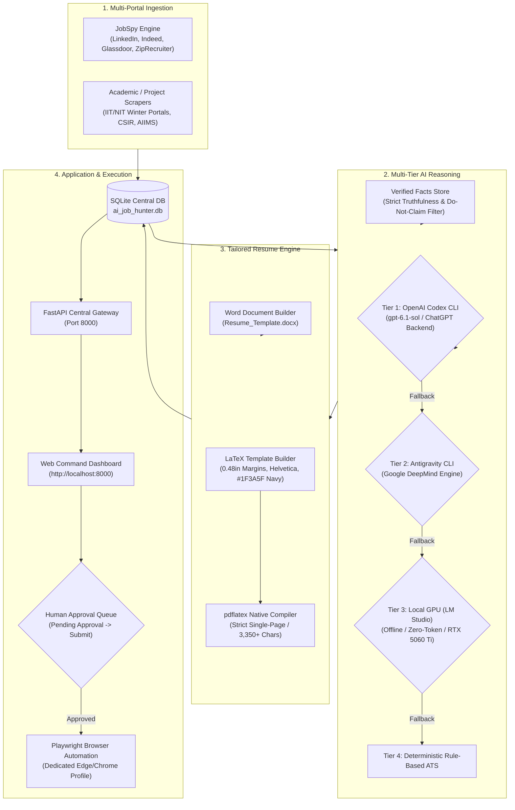

# 🚀 My Job Feed — Autonomous AI Job Hunter & Application Platform

[](https://python.org)
[](https://fastapi.tiangolo.com)
[](https://docker.com)
[](https://playwright.dev)
[](https://www.latex-project.org/)
[](LICENSE)

An end-to-end, fully self-hosted, autonomous job intelligence and application ecosystem. **My Job Feed** scrapes multi-portal listings (LinkedIn, Indeed, Glassdoor, ZipRecruiter), runs multi-tiered AI evaluation (OpenAI Codex, Antigravity CLI, or offline local GPU LLMs), automatically formats pixel-perfect 1-page ATS resumes in native **LaTeX (`pdflatex`)** and **Word (`.docx`)**, and conducts browser-based autofill with human-in-the-loop approval gates.

---

## 🏛️ System Architecture



---

## ✨ Key Capabilities

### 1. 🧠 Multi-Tier AI Reasoning (Cloud & Zero-Token Offline)
* **Tier 1 — OpenAI Codex CLI:** Runs non-interactive structured JSON matching via `codex exec` powered by `gpt-6.1-sol`.
* **Tier 2 — Google Antigravity CLI:** Leverages local `agy` CLI subagent workflows for deep job context scoring.
* **Tier 3 — Local GPU (LM Studio):** Zero-token, 100% offline inference on local NVIDIA GPUs (e.g., RTX 5060 Ti) over `http://127.0.0.1:1234/v1`.
* **Anti-Hallucination Guardrails:** The `VerifiedFactsStore` strictly forbids the LLM from inventing credentials, dates, companies, or unverified skills (*enforces strict blacklist on forbidden claims*).

### 2. 📄 Publication-Grade 1-Page ATS Resumes
* **Automated LaTeX (`pdflatex`) & DOCX Compilation:** Generates publication-quality resumes from standardized templates in `template/Resume_Template.tex` and `template/Resume_Template.docx`.
* **ATS Naming Conventions:** Every file is automatically titled per corporate recruitment standards:
  $$\mathbf{Sukesh\_Periyasamy\_\{JobRole\}\_\{CompanyName\}\_Resume.pdf}$$
* **Strict Single-Page Fit:** Micro-typography calibrated to fit complete technical profiles, education, production projects, and research fellowships into a strict 1-page layout with ~3,350+ extractable characters.

### 3. 🌐 Playwright Browser Automation & Sandbox Isolation
* **Safe Sandbox Profile:** Operates in an isolated Chromium/Edge user-data profile in `browser-profiles/`. Personal browser sessions, passwords, and history are never touched.
* **Human-in-the-Loop Approval:** No job application is submitted autonomously without manual verification in the dashboard queue.
* **Idempotency Protection:** Every application attempt generates a cryptographically unique idempotency token to prevent double submissions.

### 4. 🔄 System Autostart & Background Daemon
* Includes silent Windows startup scripts (`Start-AIJobHunter.vbs` & `autostart.ps1`) to initialize WSL2 Docker, JobNavigator, and the FastAPI backend silently upon system reboot without popup terminal windows.

---

## 📂 Project Structure

```text
C:\sukesh\job\
├── config/
│   └── profile.json           # Verified candidate profile facts & preferences
├── template/
│   ├── Resume_Template.tex    # Master LaTeX resume template (Helvetica, Navy accent)
│   └── Resume_Template.docx   # Master Word resume template
├── services/
│   ├── integration_bridge/    # FastAPI API gateway, REST models, and database bridge
│   ├── resume_engine/         # AI job matcher, verified facts store, and LaTeX/DOCX builder
│   ├── browser_manager/       # Playwright browser manager with isolated user profile
│   ├── application_engine/    # Form field mapper, auto-filler, and submission tracker
│   └── job_collector/         # JobSpy scraper wrapper for multi-board querying
├── dashboard/
│   └── index.html             # Real-time web command center
├── data/
│   ├── resumes/               # Master resumes (.pdf, .docx, .tex)
│   └── generated-pdfs/        # Role-tailored ATS resumes per job
├── database/
│   └── ai_job_hunter.db       # Central SQLite database
├── browser-profiles/          # Dedicated persistent browser isolate
├── scripts/
│   ├── start.ps1              # Start all platform daemons
│   ├── stop.ps1               # Safely stop all services
│   ├── status.ps1             # Query system and container health
│   ├── autostart.ps1          # Background startup runner for Windows
│   └── run_jobspy.ps1         # Trigger targeted multi-board scrapers
├── tests/                     # Unit, integration, and E2E test suites
└── docs/                      # Comprehensive technical architecture & audit docs
```

---

## ⚡ Quick Start

### Prerequisites
* **Operating System:** Windows 11 with WSL2 (Ubuntu 24.04 recommended)
* **Python:** 3.12+ (in virtual environment `C:\sukesh\job\.venv`)
* **Docker:** Docker CE / Docker Desktop running inside WSL2
* **TeX Live:** `pdflatex` (installed via `texlive-latex-extra` and `texlive-fonts-recommended`)
* **AI Engines (Optional):** OpenAI Codex CLI, Google Antigravity CLI, or LM Studio

### 1. Launch Platform
Start all background daemons and dashboards with a single command:
```powershell
powershell -ExecutionPolicy Bypass -File C:\sukesh\job\scripts\start.ps1
```

### 2. Access the Command Center
Open your browser to view your live job queue, match scores, and tailored resumes:
* **Command Dashboard:** [http://localhost:8000](http://localhost:8000)
* **API Documentation:** [http://localhost:8000/docs](http://localhost:8000/docs)
* **JobNavigator UI:** [http://localhost:3000](http://localhost:3000)

### 3. Check System Status
```powershell
powershell -ExecutionPolicy Bypass -File C:\sukesh\job\scripts\status.ps1
```

### 4. Stop Services
```powershell
powershell -ExecutionPolicy Bypass -File C:\sukesh\job\scripts\stop.ps1
```

---

## 🛠️ CLI Operations

### Run Multi-Board Job Scraping
Discover fresh job openings across LinkedIn, Indeed, and Glassdoor:
```powershell
powershell -ExecutionPolicy Bypass -File C:\sukesh\job\scripts\run_jobspy.ps1 -SearchTerm "Embedded Firmware" -Location "Bengaluru" -Results 10
```

### Run Batch Tailoring for Candidate
Score all discovered jobs and compile tailored LaTeX resumes:
```powershell
& C:\sukesh\job\.venv\Scripts\python.exe C:\sukesh\job\scripts\rename_all_job_resumes.py
```

### Execute End-to-End Tests
Validate scrapers, database integrity, resume compilation, and browser isolates:
```powershell
& C:\sukesh\job\.venv\Scripts\python.exe C:\sukesh\job\tests\test_end_to_end_flow.py
```

---

## 🛡️ Ethics, Privacy & Anti-Hallucination Rules

1. **Self-Hosted Privacy:** All scraped data, applicant details, resume variations, and database records remain 100% on your local machine.
2. **Deterministic Fact Verification:** AI models are strictly constrained by the `VerifiedFactsStore`. If a degree, certification, or tool is not in `config/profile.json`, the engine will **never** claim it on a resume.
3. **No Unattended Submissions:** The application automation engine pauses before final submission and requests human authorization in the approval queue.
4. **Browser Isolation:** Dedicated user profile directories ensure zero interference with your primary personal or work browser data.

---

## 📄 License
This project is licensed under the [MIT License](LICENSE).

## Career Ops integration

The **Career Ops** dashboard tab imports public employer/remote feeds and checks
saved job availability while retaining this project's screening and approval queue.
See [setup, supported providers and limits](docs/21-career-ops-integration.md) and
[upstream attribution](integrations/career-ops/NOTICE.md).

## Extended discovery and freelance projects

**Discovery coverage** integrates the FreeHire search/parser from the supplied
AI Job Search repository, with rotating India/remote queries and explicit import,
duplicate and exclusion counts. **Freelancing** tracks project briefs, budgets,
editable proposal drafts and client stages. See [usage and integration limits](docs/22-extended-discovery-and-freelancing.md)
and [source attribution](integrations/ai-job-search/NOTICE.md).
